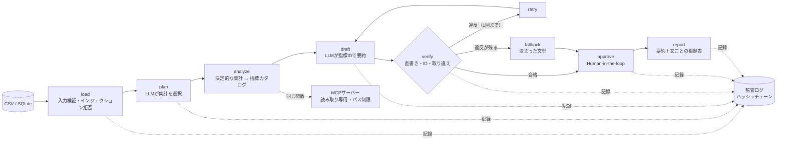

# jissoku-agent：数値を作らせない業務データ分析AIエージェント（LangGraph／MCP／ローカルLLM）

[](https://github.com/takashi-101/jissoku-agent/actions/workflows/tests.yml)
[](https://github.com/takashi-101/jissoku-agent/actions/workflows/codeql.yml)
   -black) 

自治体・大学の窓口業務の日次データから、**滞留の推移、条件別の層別比較、週次のボトルネック、必要人員**を算出し、LLMに要約させてレポートにするエージェントです。行政の報告で許されない「数値の誤り」と「指標の取り違え」を、仕組みで防いでいます。

## 30秒で読む要点
- **LLMに数値を書かせない**：LLMは `{M3}` のような指標IDで数値を参照するだけで、値はコードが集計結果から差し込みます。数字の直書き・漢数字・存在しないID・**指標の取り違え**を検出し、違反があれば再生成（1回）、それでも残ればLLMの要約を採用しません。
- **評価で示す**：ガードレールの検出率を決定的に評価し（[evals/RESULTS.md](evals/RESULTS.md)）、CIで100%を要求しています。指標の取り違えは、同じ単位の全486組で検出、値が同じ組も含みます。
- **ガバナンスとセキュリティ**：プロンプトインジェクションと個人情報の送信停止、接続先の許可リスト、MCPのパス制限、ハッシュチェーンで改ざんに気づける監査ログ、SQLとPythonの検算、Human-in-the-loopの承認。
- **費用ゼロ・閉域対応**：ローカルLLM（Ollama）とMCP（標準入出力）のみで、有料APIは使いません。LLMが無くてもルールベースで最後まで動き、コンテナは通信を遮断して実行できます。

| 求人で求められている技術 | 実装 | 知識の裏付け（Credly等） |
|---|---|---|
| AIエージェント（LangGraph） | `jissoku/agent.py` | [Agentic AI with LangChain and LangGraph](https://www.credly.com/badges/bc08f1a5-df4d-4111-899f-46d43ebdd1ad) |
| ガードレール・評価 | `jissoku/grounding.py`、`evals/` | [IBM Generative AI Engineering Professional Certificate](https://www.credly.com/badges/7364adab-8350-4eef-b94c-94e8dc659570) |
| MCP（ツール連携） | `mcp_server.py` | [Build AI Agents Using MCP](https://www.credly.com/badges/eb0ddb53-3a26-48ba-95d6-cbc242ed24bc) |
| Python・データ分析 | `jissoku/tools.py` | [Data Analysis with Python](https://www.credly.com/badges/a1425bcf-2c74-43eb-a7f9-2edd448788db) |
| SQL・データパイプライン | `jissoku/store.py` | [AWS Educate Getting Started with Databases](https://www.credly.com/badges/0f3404b3-6419-4d48-934f-507f0364e032) |
| セキュリティ・ガバナンス | `jissoku/guard.py`、`jissoku/audit.py`、[SECURITY.md](SECURITY.md) | [AWS Knowledge: Security Champion](https://www.credly.com/badges/ddab077d-58eb-4807-bec1-69e5c6aeb9a5) |
| コンテナ・CI/CD | `Dockerfile`、`.github/workflows/` | [AWS Knowledge: Amazon ECS](https://www.credly.com/badges/b73f91ba-c58c-42ce-a05a-c8909e4a4354) |

求人の出典と、Palantir・OpenAI Academy・Claude Academyの修了証を含む全体の対応表：[docs/skills-evidence.md](docs/skills-evidence.md)

## アーキテクチャ


## 数値のグラウンディング（指標ID方式）
| 段階 | 内容 |
|---|---|
| 1. 指標カタログ | 集計結果から、参照できる指標（ID・名称・値・単位・確認語）を作る。例：`M3 = 郵送請求の最大の未処理件数 = 26件`（確認語：郵送請求、最大） |
| 2. 下書き | LLMは `郵送請求は、未処理が{M4}に最大の{M3}になり…` のようにIDで書く |
| 3. 検証 | ①IDの外に数字（漢数字を含む）が無い ②IDが実在する ③IDを参照した文に、その指標の確認語がすべて含まれる |
| 4. 描画 | 合格した要約だけ、値と単位を差し込む。レポートには文ごとの根拠表（数値・指標名・集計結果の場所）を付ける |

「期末」と書いた文で「最大」の値を参照する、といった取り違えは、**値が同じでも**検出します（見本データでは最大と期末がどちらも26件）。

## 評価結果（`python evals/run_evals.py`）
| 評価項目 | 結果 |
|---|---|
| 正しい参照が通る（誤検出の確認） | 42/42 |
| 数字の直書き／漢数字／存在しないIDを検出 | 42/42、8/8、42/42 |
| 指標の取り違えを検出（同じ単位の全組み合わせ） | 486/486（値が同じ組 6/6） |
| 違反のあるLLM要約を最終報告から除外 | 4/4 |
| 業務名に混ぜた指示文を拒否／個人情報の可能性を検出 | 8/8、4/4 |
| MCPで許可外のファイルを拒否 | 5/5 |

## 実行
```
pip install -r requirements.txt
python run_agent.py sample/minato_shiminka.csv --settings sample/settings.json
```
要約と文ごとの根拠が表示され、承認すると `report.md` を保存します（差し戻すと保存しません）。生成例：[sample/report_example.md](sample/report_example.md)

| 使い方 | コマンド |
|---|---|
| ローカルLLMを使う | `python run_agent.py sample/minato_shiminka.csv --settings sample/settings.json --model qwen2.5:7b` |
| SQLiteに取り込み、検算する | `python -m jissoku.store load sample/minato_shiminka.csv --db data/jissoku.db` → `python -m jissoku.store reconcile --db data/jissoku.db` |
| SQLiteから分析する | `python run_agent.py data/jissoku.db --settings sample/settings.json` |
| 監査ログを検証する | `python -m jissoku.audit verify audit/audit.jsonl` |
| 通信を遮断したコンテナで動かす | `docker build -t jissoku-agent .` → `docker run --rm --network none jissoku-agent` |
| テストと評価 | `python -m unittest tests.test_basic`、`python evals/run_evals.py --check` |

### MCPサーバー（Claude Desktop の設定例）
```json
{ "mcpServers": { "jissoku": { "command": "python", "args": ["C:/work/jissoku-agent/mcp_server.py"],
  "env": { "JISSOKU_DATA_DIR": "C:/work/jissoku-data" } } } }
```
道具：`backlog`、`stratify`、`weekly_bottleneck`、`staffing`、`metric_catalog`（参照できる指標の一覧）、`render_summary`（IDで書いた要約を検証して描画）

## テスト（17件）
集計の整合（未処理の収支）、指標ID方式の検証（正しい参照・直書き・漢数字・値が同じ指標の取り違え・存在しないID）、エージェント（ルールベース、LLMの違反→再生成→切り替え、個人情報を含む質問をLLMに送らないこと、差し戻し）、監査ログの改ざん検出、指示文の混入の拒否、外部の接続先の拒否、SQLiteの取り込みの冪等性とSQL・Pythonの検算、MCP（一覧・呼び出し・要約の検証・パスの抜け道の拒否）。

## 制約
- 取り違えの検出は、参照した文に含まれる語による判定です。差し替え先の指標を表す語が、すべて同じ文にたまたま含まれる場合は検出できません。
- 個人名は検出していません。区分に個人名を入れない運用を前提にしています。
- LLMありの経路は、応答を固定した差し替えで検証しています。必要人員は「受付件数 × 1件あたりの時間 ÷ 1人1日の作業時間」による概算です。

## 背景（業務知識）
- 福岡市役所で、日々の処理件数を業務の種類ごと・区ごとに手で数え、週ごとに詰まっている箇所を解消しました。市からは、その記録を人員体制の検討に使いたいと求められました。
- 大学で、駐車場の利用を、晴れの日・雨の日・行事のある日など条件別に実測し、許可枚数を決め直しました。

この手順（日次の実測 → 条件別の層別 → 週次のボトルネック → 必要人員）を、誰が使っても同じ結果になるエージェントにしたものです。

## 入力の形式
| 列 | 内容 | 例 |
|---|---|---|
| 日付 | YYYY-MM-DD | 2026-10-30 |
| 業務 | 業務の種類（40文字以内） | 郵送請求 |
| 区分 | 窓口・区・支所など（個人名は入れない） | 本庁 |
| 受付件数 | その日に受け付けた件数 | 25 |
| 処理件数 | その日に処理を終えた件数 | 20 |
| 条件 | その日の条件（複数は「;」区切り） | 月末;雨 |

設定（JSON）：業務ごとの1件あたりの時間（分）、1人1日の作業時間（分）、期首の未処理件数。`sample/settings.json` を参照。

## ファイル構成
```
jissoku/
  agent.py        LangGraphのグラフ定義とレポート生成
  grounding.py    指標カタログ、指標ID方式の検証と描画
  tools.py        集計（標準ライブラリのみ）
  guard.py        プロンプトインジェクション・個人情報の検査
  llm.py          Ollamaクライアント（接続先の許可リスト、転送を追わない）
  audit.py        ハッシュチェーンの監査ログ
  store.py        SQLiteへの取り込みと検算
run_agent.py      CLI（承認プロンプト付き）
mcp_server.py     MCPサーバー（読み取り専用）
evals/            ガードレールの評価と結果
tests/            ユニットテスト
docs/             求められている技術との対応表、脅威と対策
sample/           見本データ（架空）、設定、レポート例
Dockerfile        非rootユーザー、通信遮断で実行
.github/          CI、CodeQL、Dependabot
```

## ライセンス
MIT
